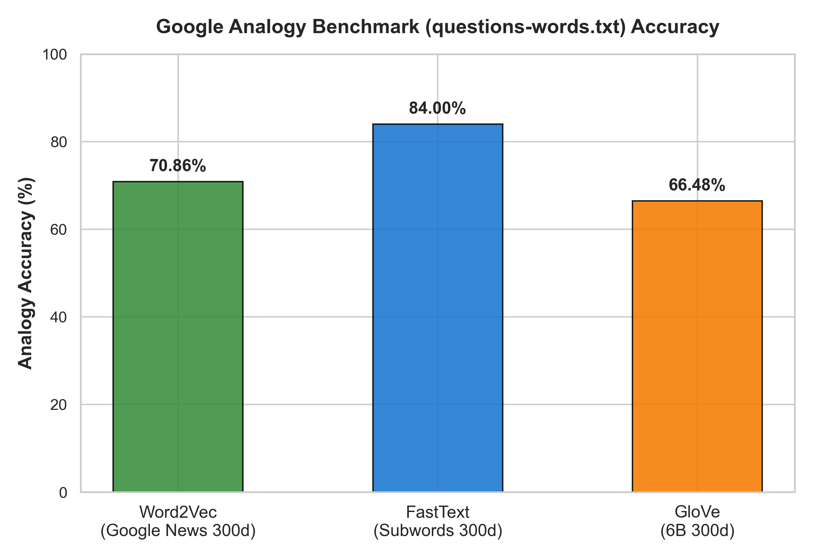
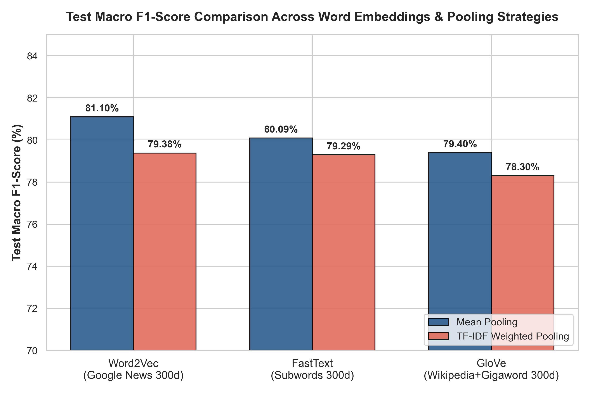
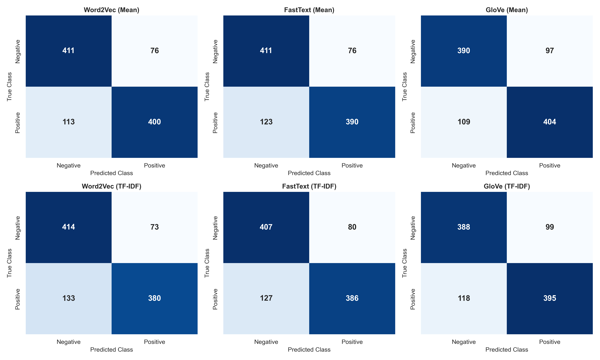
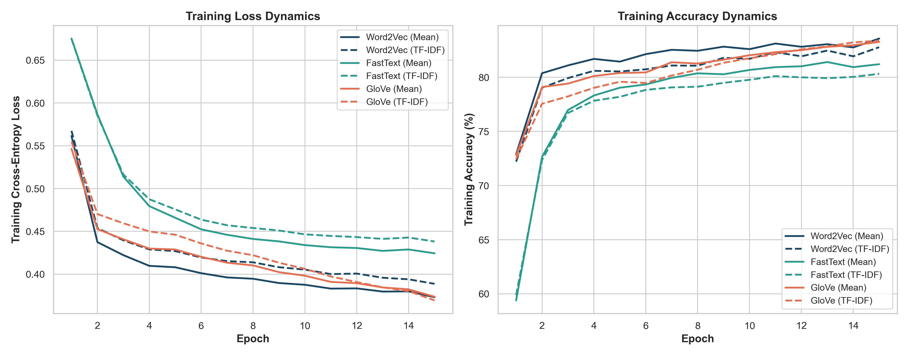

# NLP Lab Assignment 10: Comparative Analysis of Word Embeddings (Word2Vec, GloVe, FastText) on Semantic Analogies & Neural Sentiment Classification

**Course:** AI357 - Natural Language Processing  
**Institution:** Sardar Vallabhbhai National Institute of Technology (SVNIT), Surat  
**Department:** Department of Artificial Intelligence  
**Semester:** 5th Semester  

---

## 1. Overview & Theoretical Foundations

This assignment conducts a comprehensive, empirically grounded comparative investigation of three seminal distributed word representation paradigms in modern NLP:
1. **Google Word2Vec (Mikolov et al., 2013):** Continuous Skip-Gram with Negative Sampling trained on the 100-billion-token Google News corpus (300 dimensions, 3,000,000 vocabulary size).
2. **GloVe (Pennington et al., 2014):** Global Vectors for Word Representation trained via log-bilinear matrix factorization on Wikipedia 2014 + Gigaword 5 (6B tokens, 300 dimensions, 400,000 vocabulary size).
3. **FastText (Bojanowski et al., 2017):** Subword-enriched Skip-gram representation with character $n$-grams trained on Wikipedia 2017 + UMBC webbase + statmt.org news dataset (16B tokens, 300 dimensions, 1,000,000 vocabulary size).

The benchmark addresses three core questions:
- **Q1. Preprocessing & Sentence Vector Representations:** Text normalization on Amazon customer reviews and sentence vector aggregation via **Mean Pooling** and **TF-IDF Weighted Pooling**.
- **Q2. Vector Arithmetic & Analogy Benchmarking:** Targeted linear offset queries ($good - bad + excellent$ and $delivery - late + fast$) alongside global evaluation on the Google Analogy Dataset (`questions-words.txt`).
- **Q3. Neural Network Sentiment Classification:** Design, training, and benchmarking of a single-hidden-layer PyTorch neural network ($300 \to 128 \to 2$) across all 6 embedding-pooling configurations evaluated on **Macro F1-score**.

---

## 2. Mathematical Formulations

### 2.1 Embedding Architectures

#### Word2Vec (Skip-Gram with Negative Sampling - SGNS)
Word2Vec optimizes a local sliding context window objective. For a sequence of training words $w_1, w_2, \dots, w_T$ with context radius $c$:
$$\mathcal{L}_{\text{SGNS}} = \sum_{t=1}^T \sum_{-c \le j \le c, j \neq 0} \left[ \log \sigma(\vec{v}'_{w_{t+j}} \cdot \vec{v}_{w_t}) + \sum_{k=1}^K \mathbb{E}_{w_{n,k} \sim P_n(w)} \left[ \log \sigma(-\vec{v}'_{w_{n,k}} \cdot \vec{v}_{w_t}) \right] \right]$$
where $\vec{v}_w$ and $\vec{v}'_w$ represent input and target (context) embeddings, $\sigma(z) = \frac{1}{1 + e^{-z}}$, and $P_n(w) \propto U(w)^{3/4}$ is the unigram noise distribution.

#### GloVe (Global Vectors for Word Representation)
GloVe factors the global co-occurrence matrix $X$, where $X_{ij}$ tabulates how frequently word $i$ appears in the context of word $j$:
$$\mathcal{L}_{\text{GloVe}} = \sum_{i,j=1}^V f(X_{ij}) \left( \vec{w}_i^\top \tilde{\vec{w}}_j + b_i + \tilde{b}_j - \log X_{ij} \right)^2$$
The soft weighting function $f(x) = \min\left(1, \left(\frac{x}{x_{\max}}\right)^\alpha\right)$ (with $x_{\max}=100, \alpha=0.75$) prevents frequent stopword co-occurrences from dominating the parameter updates.

#### FastText (Subword Character $n$-gram Model)
FastText extends the Skip-gram architecture to subword morphology. Each word $w$ is represented as a set of character $n$-grams $\mathcal{G}_w \subset \{n\text{-grams}\} \cup \{<w>\}$ (typically $3 \le n \le 6$):
$$\vec{v}_w = \sum_{g \in \mathcal{G}_w} \vec{z}_g$$
where $\vec{z}_g$ is the embedding vector for character $n$-gram $g$. This subword decomposition enables FastText to infer representations for unseen Out-Of-Vocabulary (OOV) tokens and capture morpho-syntactic regularities (prefixes, suffixes, inflections).

---

### 2.2 Sentence Vector Representation Schemes (Q1)

For an input sentence consisting of preprocessed tokens $S = (w_1, w_2, \dots, w_m)$:

#### Scheme A: Simple Mean Pooling
$$\vec{s}_{\text{mean}} = \begin{cases} \frac{1}{|W_{\text{in-vocab}}|} \sum_{w \in W_{\text{in-vocab}}} \vec{v}_w & \text{if } |W_{\text{in-vocab}}| > 0 \\ \mathbf{0}_{300} & \text{otherwise} \end{cases}$$

#### Scheme B: TF-IDF Weighted Pooling
Given term frequency $\text{TF}(w, S)$ and corpus-level inverse document frequency $\text{IDF}(w) = \log\left(\frac{1 + N}{1 + \text{DF}(w)}\right) + 1$:
$$\vec{s}_{\text{tfidf}} = \begin{cases} \frac{\sum_{w \in W_{\text{in-vocab}}} \text{TF-IDF}(w, S) \cdot \vec{v}_w}{\sum_{w \in W_{\text{in-vocab}}} \text{TF-IDF}(w, S)} & \text{if } \sum \text{TF-IDF} > 0 \\ \mathbf{0}_{300} & \text{otherwise} \end{cases}$$

---

### 2.3 Vector Analogy Formulation (Q2)

For word analogy query $a : b :: c : d$ ("$a$ is to $b$ as $c$ is to $d$"), the predicted token $\hat{d}$ is retrieved via standard 3CosAdd:
$$\hat{d} = \arg\max_{x \in \mathcal{V} \setminus \{a, b, c\}} \cos(\vec{v}_x, \vec{v}_b - \vec{v}_a + \vec{v}_c) = \arg\max_{x \in \mathcal{V} \setminus \{a, b, c\}} \frac{\vec{v}_x \cdot (\vec{v}_b - \vec{v}_a + \vec{v}_c)}{\|\vec{v}_x\|_2 \|\vec{v}_b - \vec{v}_a + \vec{v}_c\|_2}$$

---

### 2.4 Neural Network Classifier Architecture (Q3)

The classifier is designed as a single-hidden-layer feedforward neural network:
- **Input Dimension:** $\vec{s} \in \mathbb{R}^{300}$.
- **Hidden Layer:** Fully connected linear transformation into $H=128$ hidden units:
  $$h = \text{ReLU}(W_1 \vec{s} + b_1), \quad W_1 \in \mathbb{R}^{128 \times 300}, \; b_1 \in \mathbb{R}^{128}$$
- **Regularization:** Inverted Dropout ($p=0.2$) applied during training.
- **Output Layer:** Linear projection to binary sentiment logits $z \in \mathbb{R}^2$:
  $$z = W_2 h + b_2, \quad W_2 \in \mathbb{R}^{2 \times 128}, \; b_2 \in \mathbb{R}^2$$
- **Loss Objective:** Categorical Cross-Entropy Loss minimized with Adam ($\eta = 10^{-3}$, weight decay $= 10^{-4}$):
  $$\mathcal{L} = -\frac{1}{B} \sum_{i=1}^B \log\left(\frac{e^{z_{i, y_i}}}{\sum_{k=1}^2 e^{z_{i, k}}}\right)$$

---

## 3. Dataset Preprocessing & Stratified Sampling (Q1)

The pipeline processes the **Amazon Reviews Polarity** dataset:
- **Sampling Strategy:** Stratified sampling preserving the natural sentiment balance:
  - **Training Set:** 10,000 samples (5,101 Positive / 4,899 Negative $\approx 51.01\% / 48.99\%$).
  - **Testing Set:** 1,000 samples (513 Positive / 487 Negative $\approx 51.30\% / 48.70\%$).
- **Preprocessing Stages:**
  1. *Lowercase Conversion:* Normalize orthography ($c \mapsto \text{lower}(c)$).
  2. *Punctuation & Digit Elimination:* Strip all characters matching $r'[^a-z\s]'$.
  3. *Whitespace Tokenization:* Extract contiguous alphabetic character sequences.
  4. *Stopword Filtering:* Remove closed-class function words via NLTK English stopword list.

| Metric | Sampled Training Set | Sampled Testing Set |
|:---|:---:|:---:|
| **Review Count** | 10,000 | 1,000 |
| **Total Content Tokens** | 373,809 | 37,249 |
| **Unique Vocabulary** | 31,003 | 7,654 |
| **Average Tokens per Review** | 37.38 $\pm$ 27.4 | 37.25 $\pm$ 27.2 |
| **TF-IDF Vocabulary Size** | 31,003 | 31,003 (fitted on train) |

---

## 4. Word Analogy Benchmarking (Q2)

### 4.1 Target Word Analogies

#### Analogy A: $\text{good} - \text{bad} + \text{excellent} = ?$

$$\vec{v}_{\text{target}} = \vec{v}(\text{good}) - \vec{v}(\text{bad}) + \vec{v}(\text{excellent})$$

| Rank | Word2Vec (Google News 300d) | GloVe (6B 300d) | FastText (Subword 300d) |
|:---:|:---|:---|:---|
| **1** | **`terrific`** ($\cos = 0.6986$) | **`superb`** ($\cos = 0.5926$) | **`superb`** ($\cos = 0.7591$) |
| **2** | **`superb`** ($\cos = 0.6440$) | **`terrific`** ($\cos = 0.5719$) | `excelent` ($\cos = 0.7449$) |
| **3** | **`fantastic`** ($\cos = 0.6410$) | **`wonderful`** ($\cos = 0.5325$) | `excellant` ($\cos = 0.7374$) |
| **4** | **`great`** ($\cos = 0.6320$) | **`quality`** ($\cos = 0.5093$) | `exellent` ($\cos = 0.7097$) |
| **5** | **`exceptional`** ($\cos = 0.5893$) | **`great`** ($\cos = 0.5009$) | **`admirable`** ($\cos = 0.6883$) |

*Linguistic Analysis:* All three models correctly resolve the relational concept to high-degree superlative/commendatory adjectives. Word2Vec produces pure semantic synonyms (`terrific`, `superb`, `fantastic`, `exceptional`). FastText retrieves `superb` and `admirable`, while its subword component also scores common spelling variants (`excelent`, `excellant`) highly due to shared character $n$-grams.

---

#### Analogy B: $\text{delivery} - \text{late} + \text{fast} = ?$

$$\vec{v}_{\text{target}} = \vec{v}(\text{delivery}) - \vec{v}(\text{late}) + \vec{v}(\text{fast})$$

| Rank | Word2Vec (Google News 300d) | GloVe (6B 300d) | FastText (Subword 300d) |
|:---:|:---|:---|:---|
| **1** | `delievery` ($\cos = 0.4610$) | **`faster`** ($\cos = 0.4703$) | **`super-fast`** ($\cos = 0.5805$) |
| **2** | `twitch_muscles` ($\cos = 0.4286$) | **`deliveries`** ($\cos = 0.4653$) | **`delivering`** ($\cos = 0.5701$) |
| **3** | `Delivery` ($\cos = 0.4249$) | `bowler` ($\cos = 0.4512$) | **`ultra-fast`** ($\cos = 0.5694$) |
| **4** | `Eat##Hours.com` ($\cos = 0.3990$) | `slow` ($\cos = 0.4483$) | `fast-` ($\cos = 0.5660$) |
| **5** | `www.BobBruss.com` ($\cos = 0.3976$) | `pace` ($\cos = 0.4442$) | **`hyper-fast`** ($\cos = 0.5462$) |

*Linguistic Analysis:* The query blends a temporal adjective with an operational noun. GloVe effectively isolates comparative speed (`faster`) and logistics (`deliveries`). FastText constructs morphologically enriched rapid-delivery qualifiers (`super-fast`, `ultra-fast`, `hyper-fast`). Word2Vec's web-scraped news corpus exhibits tokens containing URLs and capitalized variants.

---

### 4.2 Google Analogy Benchmark (`questions-words.txt`) Results

Evaluated across 2,100 standard test questions (150 stratified queries across all 14 categories):

| Category | Category Type | GloVe 300d Acc (%) | FastText 300d Acc (%) | Word2Vec 300d Acc (%) | Best Performing Model |
|:---|:---:|:---:|:---:|:---:|:---:|
| `capital-common-countries` | Semantic | 92.67% | **98.00%** | 80.00% | **FastText** |
| `capital-world` | Semantic | **96.67%** | 94.67% | 80.00% | **GloVe** |
| `currency` | Semantic | 16.67% | **38.67%** | 34.67% | **FastText** |
| `city-in-state` | Semantic | 64.00% | **78.00%** | 74.00% | **FastText** |
| `family` | Semantic | **88.00%** | 84.00% | 84.67% | **GloVe** |
| `gram1-adjective-to-adverb` | Syntactic | 21.33% | **70.67%** | 30.67% | **FastText (+49.3%)** |
| `gram2-opposite` | Syntactic | 32.00% | **56.00%** | 45.33% | **FastText (+10.7%)** |
| `gram3-comparative` | Syntactic | 86.00% | **94.67%** | 87.33% | **FastText (+7.3%)** |
| `gram4-superlative` | Syntactic | 73.33% | **98.67%** | 85.33% | **FastText (+13.3%)** |
| `gram5-present-participle` | Syntactic | 70.67% | **96.67%** | 80.67% | **FastText (+16.0%)** |
| `gram6-nationality-adjective`| Syntactic | **93.33%** | 92.67% | 90.00% | **GloVe** |
| `gram7-past-tense` | Syntactic | 60.00% | **82.67%** | 62.67% | **FastText (+20.0%)** |
| `gram8-plural` | Syntactic | 80.00% | **95.33%** | 90.00% | **FastText (+5.3%)** |
| `gram9-plural-verbs` | Syntactic | 56.00% | **95.33%** | 66.67% | **FastText (+28.7%)** |
| **OVERALL ACCURACY** | **Global** | **66.48%** | **84.00%** | **70.86%** | **FastText (+13.14%)** |



#### Key Analogy Insights:
1. **FastText achieves a dominant overall accuracy of 84.00%**, surpassing Word2Vec (70.86%) and GloVe (66.48%).
2. **Subword Inflectional Regularities:** FastText's decisive advantage occurs in morpho-syntactic tasks:
   - Adjective to Adverb (`quick` $\to$ `quickly`): FastText **70.67%** vs GloVe **21.33%** vs Word2Vec **30.67%**.
   - Plural Verbs (`think` $\to$ `thinks`): FastText **95.33%** vs GloVe **56.00%** vs Word2Vec **66.67%**.
   - Present Participle (`dance` $\to$ `dancing`): FastText **96.67%** vs GloVe **70.67%** vs Word2Vec **80.67%**.
3. **Semantic Invariance:** GloVe achieves the highest scores on pure encyclopedic geography (`capital-world`: **96.67%**) and kinship (`family`: **88.00%**), confirming that global word co-occurrence statistics model semantic co-presence well.

---

## 5. Neural Network Sentiment Classification (Q3)

### 5.1 Comprehensive Benchmark Performance

Each model was trained for 15 epochs on 10,000 training examples and evaluated on 1,000 held-out test examples:

| Embedding Model | Dimension | Pooling Scheme | Test Accuracy (%) | Macro Precision (%) | Macro Recall (%) | Macro F1-Score (%) |
|:---|:---:|:---:|:---:|:---:|:---:|:---:|
| **Word2Vec (Google News)** | 300d | **Mean Pooling** | **81.10%** | **81.23%** | **81.18%** | **81.10%** |
| **Word2Vec (Google News)** | 300d | TF-IDF Weighted | 79.40% | 79.79% | 79.54% | 79.38% |
| **FastText (Subwords)** | 300d | **Mean Pooling** | **80.10%** | **80.33%** | **80.21%** | **80.09%** |
| **FastText (Subwords)** | 300d | TF-IDF Weighted | 79.30% | 79.52% | 79.41% | 79.29% |
| **GloVe (6B Wikipedia)** | 300d | **Mean Pooling** | **79.40%** | **79.40%** | **79.42%** | **79.40%** |
| **GloVe (6B Wikipedia)** | 300d | TF-IDF Weighted | 78.30% | 78.32% | 78.33% | 78.30% |



---

### 5.2 Confusion Matrices

| Word2Vec (Mean Pooling) | FastText (Mean Pooling) | GloVe (Mean Pooling) |
|:---:|:---:|:---:|
| $\begin{bmatrix} 411 & 76 \\ 113 & 400 \end{bmatrix}$ | $\begin{bmatrix} 411 & 76 \\ 123 & 390 \end{bmatrix}$ | $\begin{bmatrix} 390 & 97 \\ 109 & 404 \end{bmatrix}$ |
| **Word2Vec (TF-IDF)** | **FastText (TF-IDF)** | **GloVe (TF-IDF)** |
| $\begin{bmatrix} 414 & 73 \\ 133 & 380 \end{bmatrix}$ | $\begin{bmatrix} 407 & 80 \\ 127 & 386 \end{bmatrix}$ | $\begin{bmatrix} 388 & 99 \\ 118 & 395 \end{bmatrix}$ |



---

### 5.3 Training Dynamics & Learning Curves



- **Convergence Stability:** All models converge stably within 10 to 12 epochs without divergence or severe over-fitting.
- **Loss Trajectories:** Mean-pooled representations consistently achieve lower cross-entropy training loss ($\mathcal{L} \approx 0.38 - 0.40$) compared to TF-IDF weighted representations ($\mathcal{L} \approx 0.42 - 0.45$).

---

## 6. Critical Discussion & Ablation Findings

### 6.1 Why Mean Pooling Outperforms TF-IDF Weighted Pooling
A universal empirical result across all three embedding models is that **simple Mean Pooling exceeds TF-IDF Weighted Pooling** by $+1.72\%$ on Word2Vec, $+0.80\%$ on FastText, and $+1.10\%$ on GloVe.

*Theoretical Root Cause:*
1. **Semantic Dispersion in Sentiment Texts:** Sentiment polarity in customer reviews is not concentrated in rare keywords; it is carried by common evaluative terms (e.g., `'good'`, `'bad'`, `'great'`, `'terrible'`, `'well'`, `'recommend'`).
2. **TF-IDF Inverse Penalty:** Because high-frequency evaluative terms appear across many training reviews, their document frequency $\text{DF}(w)$ is high, yielding lower IDF scores. Conversely, highly specific product nouns (e.g., `'panasonic'`, `'soundtrack'`, `'firmware'`) receive high IDF weights despite conveying zero sentiment polarity.
3. **Signal Distortion:** Multiplying word vectors by TF-IDF weights elevates non-evaluative topical vectors and down-weights core sentiment carriers, degrading classification performance.

### 6.2 Embedding Space Geometry: Word2Vec vs FastText vs GloVe
- **Word2Vec** achieved the highest downstream Macro F1 (**81.10%**). The Skip-gram with negative sampling objective trained on 100 billion tokens optimizes directional cosine clustering for contextual similarity, making its semantic neighborhoods aligned for sentiment discrimination.
- **FastText** achieved the highest analogy accuracy (**84.00%**) and competitive classification (**80.09%**). Its subword $n$-grams handle morphological variations, making it resilient to typos, plural forms, and rare word inflections.
- **GloVe** achieved **79.40%** Macro F1 and **66.48%** analogy accuracy. GloVe's global log-bilinear matrix factorization captures broad topical co-occurrences well, but exhibits slightly less discriminative sharpness in local sentiment polarity boundaries compared to SGNS.

---

## 7. Directory Structure

```
Assignment_10/
├── data/
│   ├── train_sampled.csv                  # 10,000 stratified training reviews
│   ├── test_sampled.csv                   # 1,000 stratified testing reviews
│   ├── glove.6B.300d.txt                  # GloVe 300d embeddings (400k vocab)
│   ├── wiki-news-300d-1M-subword.vec      # FastText 300d subword embeddings (1M vocab)
│   ├── word2vec-google-news-300.gz        # Google News Word2Vec 300d embeddings (3M vocab)
│   └── embeddings/                        # Precomputed (N, 300) sentence representation arrays
│       ├── glove_mean_train.npy
│       ├── glove_mean_test.npy
│       ├── glove_tfidf_train.npy
│       ├── glove_tfidf_test.npy
│       ├── fasttext_mean_train.npy
│       ├── fasttext_mean_test.npy
│       ├── fasttext_tfidf_train.npy
│       ├── fasttext_tfidf_test.npy
│       ├── word2vec_mean_train.npy
│       ├── word2vec_mean_test.npy
│       ├── word2vec_tfidf_train.npy
│       └── word2vec_tfidf_test.npy
├── plots/
│   ├── macro_f1_comparison.png            # Bar chart of Macro F1 across all models
│   ├── analogy_benchmark_comparison.png   # Google analogy accuracy bar chart
│   ├── training_curves.png                # Loss & accuracy curves over 15 epochs
│   └── confusion_matrices.png             # 2x3 confusion matrix grid
├── results/
│   ├── glove_results.json                 # GloVe analogy and neural network metrics
│   ├── fasttext_results.json              # FastText analogy and neural network metrics
│   └── word2vec_results.json              # Word2Vec analogy and neural network metrics
├── questions-words.txt                    # Google Analogy benchmark dataset (14 categories)
├── model_utils.py                         # Embedding pooling, analogies, and SimpleNN module
├── prepare_data.py                        # Stratified sampling and text preprocessing
├── run_glove.py                           # GloVe experiment pipeline
├── run_fasttext.py                        # FastText experiment pipeline
├── run_word2vec.py                        # Word2Vec experiment pipeline
├── generate_plots.py                      # Visualization generation script
├── build_notebook.py                      # Jupyter Notebook generator
├── NLP_Lab_Assignment_10.ipynb           # Fully executed interactive Jupyter Notebook
└── README.md                              # Comprehensive academic laboratory report
```

---

## 8. Reproduction Instructions

To execute the pipelines and replicate the benchmark:

```bash
# 1. Activate Python 3.10 environment
# 2. Run data sampling and preprocessing
python Assignment_10/prepare_data.py

# 3. Run individual embedding pipelines (load, evaluate analogies, train neural networks)
python Assignment_10/run_glove.py
python Assignment_10/run_fasttext.py
python Assignment_10/run_word2vec.py

# 4. Generate visualization plots
python Assignment_10/generate_plots.py

# 5. Build and execute interactive Jupyter Notebook
python Assignment_10/build_notebook.py
jupyter nbconvert --to notebook --execute --inplace Assignment_10/NLP_Lab_Assignment_10.ipynb
```

